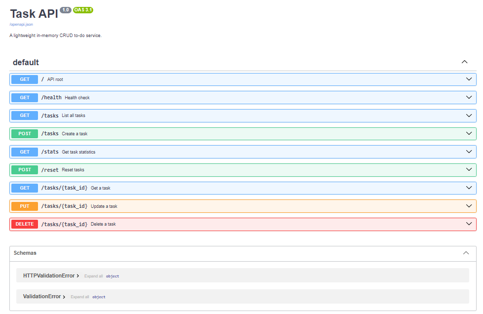

# Task API

A lightweight in-memory CRUD to-do service built with **FastAPI**.

---

## Quick Start

```bash
# 1. Install dependencies
pip install -r requirements.txt

# 2. Run the server
uvicorn main:app --reload
```

The API is now live at **http://localhost:8000**.  
Interactive Swagger docs are at **http://localhost:8000/docs**.

---

## Endpoints

| Method   | Path             | Description                | Success | Error     |
|----------|------------------|----------------------------|---------|-----------|
| `GET`    | `/`              | API metadata               | 200     | —         |
| `GET`    | `/health`        | Health check               | 200     | —         |
| `GET`    | `/tasks`         | List all tasks             | 200     | —         |
| `GET`    | `/tasks/{id}`    | Get one task               | 200     | 404       |
| `POST`   | `/tasks`         | Create a task              | 201     | 400       |
| `PUT`    | `/tasks/{id}`    | Update title and/or done   | 200     | 400, 404  |
| `DELETE` | `/tasks/{id}`    | Delete a task              | 204     | 404       |

---

## Example Session (`curl -i`)

```
$ curl -i -X POST http://localhost:8000/tasks -H 'Content-Type: application/json' -d '{"title":"Buy milk"}'
HTTP/1.1 201 Created
content-type: application/json

{"id":4,"title":"Buy milk","done":false}

$ curl -i http://localhost:8000/tasks
HTTP/1.1 200 OK
content-type: application/json

[{"id":1,"title":"Buy groceries","done":false},{"id":2,"title":"Read a book","done":true},{"id":3,"title":"Walk the dog","done":false},{"id":4,"title":"Buy milk","done":false}]

$ curl -i http://localhost:8000/tasks/4
HTTP/1.1 200 OK
{"id":4,"title":"Buy milk","done":false}

$ curl -i -X PUT http://localhost:8000/tasks/4 -H 'Content-Type: application/json' -d '{"done":true}'
HTTP/1.1 200 OK
{"id":4,"title":"Buy milk","done":true}

$ curl -i -X DELETE http://localhost:8000/tasks/4
HTTP/1.1 204 No Content

$ curl -i http://localhost:8000/tasks/99
HTTP/1.1 404 Not Found
{"error":"Task 99 not found"}
```

---

## Swagger UI



---

## Tech Stack

- Python 3.10+
- FastAPI
- Uvicorn

---

## Note on Data Storage

The data for this API is stored entirely in memory (a Python list). This means that whenever the server restarts (e.g., when you stop the uvicorn process or it reloads due to code changes), all tasks you have created, updated, or deleted will be lost, and the state will revert back to the initial seed tasks.

This motivates the need for a database (like SQLite, PostgreSQL, etc.) or a file-based storage mechanism in a real-world application to ensure data persistence across server restarts.